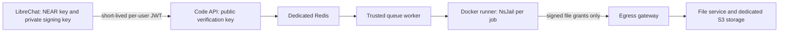

# Local data-analysis sandbox

This is an isolated Code Interpreter deployment for the company LibreChat fork.
The source release and revision are in `source.json`. The ignored `upstream/`
checkout is verified by `setup.mjs`; company deployment changes live beside it.
No NEAR key, LibreChat app directory, host workspace, or Docker socket is mounted
into the runner. The app image build excludes this entire infrastructure directory,
and the runner build context excludes `secrets/` and `.env`.

## Start and stop

With Git, Node and Docker Desktop available, from the repository root:

```sh
bash infra/code-sandbox/up.sh
```

This preserves the private app `.env` and adds dedicated Code API signing settings.
It creates separate sandbox secrets in `infra/code-sandbox/.env` (mode 0600), builds
native images, starts the private stack, and restarts LibreChat. Initial builds take
longer. Startup waits for all eight sandbox health checks before reporting success.
Subsequent builds reuse Docker's cache. Select **Data analysis** in LibreChat,
attach a CSV/XLSX file, and ask for a calculation, chart, or downloadable report.

```sh
docker compose -f infra/code-sandbox/compose.yaml --env-file infra/code-sandbox/.env ps
docker compose -f infra/code-sandbox/compose.yaml --env-file infra/code-sandbox/.env logs --tail=80 runner worker code-api
docker compose -f infra/code-sandbox/compose.yaml --env-file infra/code-sandbox/.env down
```

Stopping preserves the sandbox's private queue and object-store volumes. Code runs
fail while it is stopped; ordinary text chat still works. Do not use `down -v` unless
you intentionally want to erase sandbox artifacts. LibreChat also retains generated
files that it has already imported into its own file storage.

The local networks use 10.254.245.0/24 (control), 10.254.246.0/24 (services), and
10.254.247.0/24 (execution). These were checked against this machine's Docker networks.
Override `LOCAL_CODE_CONTROL_SUBNET` in the root `.env`, and the backend/execution
subnets in the sandbox `.env`, before first start if another host uses those ranges.

## Isolation and limits



- `control`: only LibreChat and the authenticated Code API. The runner cannot join it.
- `backend`: sandbox control services, dedicated Redis, and a digest-pinned RustFS
  S3-compatible store. No LibreChat databases or model keys are present.
- `execution`: runner, worker, and egress gateway. No sandbox ports are published.
- Each job has a new user/PID/mount/network namespace, no inherited server environment,
  a disposable workspace, and a read-only runtime. Ordinary network sockets are denied;
  output transfer uses the upstream signed, bounded egress mechanism.
- The runner container has a read-only root, a 1 GiB temporary filesystem, 2 CPUs,
  a 2 GiB memory ceiling, and 256 PIDs. Runs have a 30-second default execution limit,
  64 KiB output limit and one active runner job. The Code API's overall job budget is
  60 seconds. Python and Bash are installed; Bash is required by LibreChat's file tools
  and launches the same isolated Python interpreter. Analysis packages are locked in
  `requirements.lock`. Packages cannot be installed from the network during a job.
- Per-user Ed25519 tokens expire after at most five minutes. App-side configuration holds
  the private signing key; Code API receives its public counterpart. File ownership is
  enforced separately from knowledge of an artifact URL.

This Mac uses the official **development** NsJail mode inside Docker Desktop's Linux
VM. It requires the upstream namespace/mount capabilities listed in Compose. It shares
that VM's kernel and is not the hardened separate-kernel production boundary. Do not
claim it is secure against every malicious kernel exploit or sandbox escape.

The input data and code results still travel through LibreChat and its configured model
provider. A sandbox isolates execution; it does not remove the model from that data flow.

## Railway later

The supported target is **LibreChat on Railway, isolated Code Interpreter on a Linux
host with KVM**. Standard Railway containers are non-privileged, so this local NsJail
capability set and `/dev/kvm` runner cannot simply be moved into an ordinary Railway
service. The Code API and storage are ordinary containers, but keep the whole sandbox
stack on its dedicated execution host initially for a smaller network boundary.

The LibreChat integration remains the same. In the Railway LibreChat service set:

```dotenv
LIBRECHAT_CODE_BASEURL=https://code.your-company.example/v1
CODEAPI_AUTH_PROVIDER=librechat-jwt
CODEAPI_JWT_ENABLED=true
CODEAPI_JWT_PRIVATE_KEY_BASE64=<dedicated-production-signing-key>
CODEAPI_JWT_KID=<production-key-id>
CODEAPI_JWT_ISSUER=librechat
CODEAPI_JWT_AUDIENCE=codeapi
CODEAPI_JWT_SINGLE_TENANT_ID=<company-tenant-id>
```

Keep `NEARAI_API_KEY` in the LibreChat service only. Configure the matching public JWKS
on Code API, use fresh production internal/storage/manifest credentials, enable the
upstream KVM/MicroVM mode on that host, and expose **only** Code API behind HTTPS.
Keep runner, Redis, S3 and egress endpoints private. Do not mount the Railway project
environment or secrets into execution workers. The local names/subnets are not Railway
networking configuration.

Before rollout, qualify the KVM host with the same analysis, upload/download, cross-user,
timeout and denied-network tests, plus restart/cleanup and concurrent-user tests. Verify
the actual Railway-to-Code-API HTTPS deadline. This turn prepares and tests the protocol
locally; no Railway project, service, VM, public endpoint, or production deployment was
created, and the future KVM host has not been tested.

References: [Code Interpreter isolation](https://github.com/LibreChat-AI/code-interpreter#sandbox-isolation),
[Railway container limitation](https://railway.com/guides/github-actions-runners#known-limitations),
[RustFS Docker setup](https://docs.rustfs.com/en/installation/container/docker).
